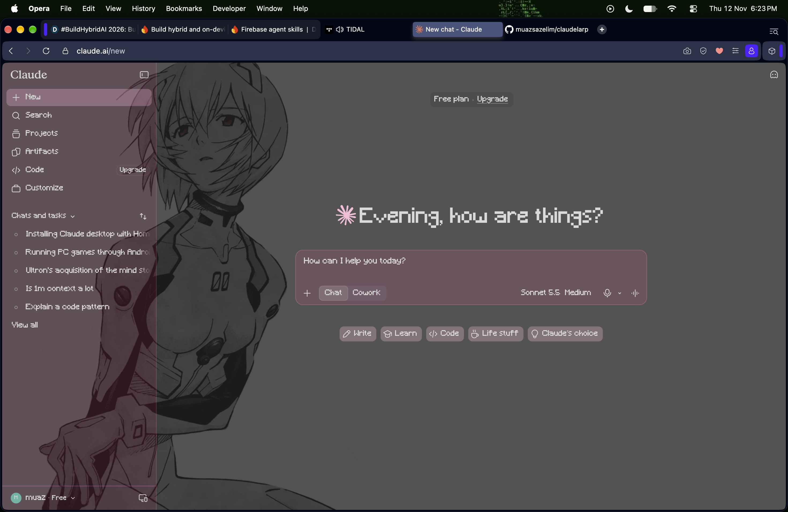
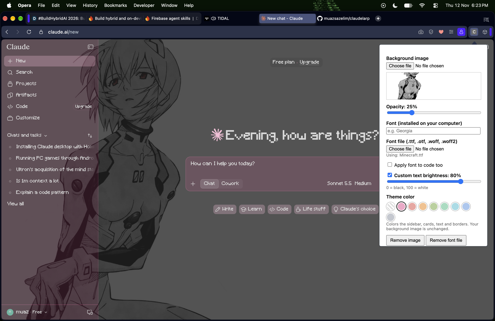

# Claude Theme

A small Chrome extension that lets you restyle [claude.ai](https://claude.ai) with your own **background image**, **font**, and **text brightness**. No build step, no dependencies. It's plain JavaScript loaded straight into Chrome.



## Features

- **Background image**: upload any image; it's drawn as a fixed layer with adjustable opacity.
- **Font**: type the name of a font installed on your computer, or **upload a font file** (`.ttf`, `.otf`, `.woff`, `.woff2`) such as a Minecraft font.
- **Apply font to code**: optionally use your font in code blocks and inline code too.
- **Theme color**: pick a preset (Blossom Pink, Ocean Blue, Moss Green, ...) and the sidebar, selected chat, cards, input box, text, borders and accents all follow it. The page background and your image are left alone.
- **Custom text brightness**: force text to a grey from black to white, handy when a light background makes text hard to read.
- Everything saves automatically and applies live, with one-click **Remove image**, **Remove font file** and **Reset all**.

## Project structure

```
claudelarp/
├── claude-theme/
│   ├── manifest.json   # Extension config (Manifest V3)
│   ├── content.js      # Runs on claude.ai and applies the theme
│   ├── popup.html      # Settings popup UI
│   └── popup.js        # Popup logic, saves settings to chrome.storage
└── img/                # Screenshots used in this README
```

## Setup

1. Clone or download this repo:
   ```bash
   git clone https://github.com/muazsazelim/claudelarp.git
   ```
2. Open `chrome://extensions` in Chrome (or any Chromium browser such as Opera or Edge).
3. Turn on **Developer mode** (top right).
4. Click **Load unpacked** and select the **`claude-theme`** folder.
5. Open https://claude.ai.
6. Click the extension icon (puzzle piece, then pin it) to open the settings popup.



## Usage

| Setting | What it does |
| --- | --- |
| **Background image** | Pick an image file. A preview appears in the popup. |
| **Opacity** | How strong the image is. Keep it low (5-30%) so text stays readable. |
| **Font (installed on your computer)** | Type an installed font's exact name, e.g. `Georgia` or `Comic Sans MS`. |
| **Font file** | Upload a font file. It takes priority over the typed font, which becomes the fallback for missing characters. |
| **Apply font to code too** | On by default. Untick to keep code blocks in monospace. |
| **Theme color** | Click a swatch to recolor the UI. "Default" (striped) restores Claude's own colors. |
| **Custom text brightness** | Tick the box, then drag the slider (0 = black, 100 = white). Code syntax colors are left alone. |

Use a low brightness value on light backgrounds and a high one on dark backgrounds.

## After editing the code

1. Click the **reload** icon on the extension card in `chrome://extensions`.
2. Refresh the claude.ai tab.

## Notes and limitations

- **Background image layer**: it's drawn on top of the page with `pointer-events: none`, so you can still click everything. Putting it behind the UI would need fragile selectors that break whenever the site updates.
- **Web fonts are blocked**: claude.ai's security policy blocks fonts loaded from other sites (e.g. Google Fonts). That's why the font must be installed locally or uploaded as a file. Uploaded fonts are registered through the browser's `FontFace` API instead.
- **Missing characters**: pixel-style fonts like Minecraft often lack accents or symbols, which fall back to the typed font or normal sans-serif.
- **Code alignment**: non-monospace fonts make code columns and indentation look uneven when "Apply font to code too" is on.
- **Storage**: your image and font are stored in the browser's extension storage (`chrome.storage.local`), not in this repo. The `unlimitedStorage` permission avoids quota errors, but use a compressed JPG for the background, since very large images may be slow.
- **Site changes**: if claude.ai's page changes and something breaks, edit the CSS in [`content.js`](claude-theme/content.js).

## License

Add a license of your choice (e.g. MIT) if you plan to share this publicly.
